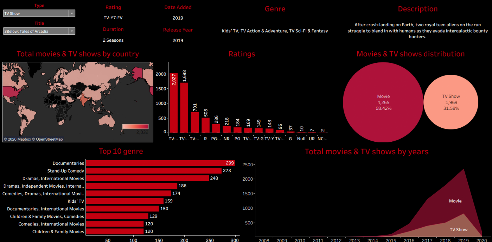

# 🎬 Netflix Movies and TV Shows Data Analysis

## 📌 Project Overview
This project analyzes Netflix Movies and TV Shows using Tableau Public. The dashboard provides insights into content distribution, ratings, genres, countries and yearly trends.

## 🖥️ Dashboard Preview

## 🎯 Project Objectives
- Analyze the distribution of Movies and TV Shows.
- Identify the top 10 genres available on Netflix.
- Explore content distribution across different countries.
- Analyze Netflix content ratings.
- Understand yearly trends in Netflix content.

## 📊 Dashboard Features
1. Total Movies and TV Shows by Country.
2. Ratings Distribution.
3. Top 10 Genres.
4. Movies vs TV Shows Distribution.
5. Movies and TV Shows by Year.
6. Interactive filters for Type and Title.
7. Content details including Genre, Description, Rating and Duration.

## 🔍 Key Insights
- Movies account for approximately 68.42% of the content.
- TV Shows account for approximately 31.58%.
- The dashboard displays 4,265 Movies and 1,969 TV Shows.
- Documentaries and Stand-Up Comedy are among the leading genres.
- Content additions increased significantly between 2017 and 2019.

## 🛠️ Tools & Technologies
- Tableau Public
- Data Visualization
- Data Analysis

## 📁 Project Files
- `Netflix_Dashboard.twbx` – Tableau packaged workbook.
- `Netflix_Dashboard.png` – Dashboard screenshot.

## 📌 Conclusion
This project helped me develop practical skills in data analysis and visualization using Tableau. It provides an interactive overview of Netflix content and highlights important trends and patterns.

---
**Created as part of my Data Analytics learning journey.**
